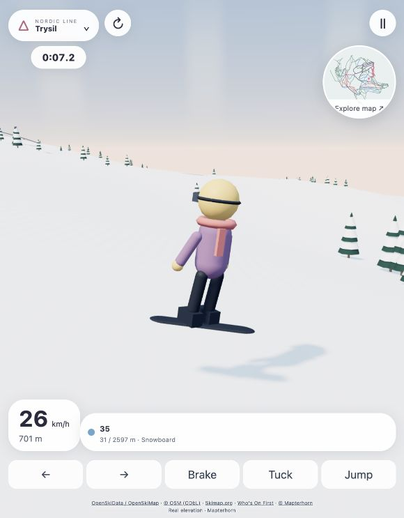

# Nordic Line

An original 3D skiing and snowboarding prototype with real Nordic resort geography.

[View the Nordic resort picker](docs/nordic-line-map.jpg)

## Play

On this Mac, double-click **Start Nordic Line.command**. It opens the game in your browser. Keep its Terminal window open while playing; close it or press Ctrl+C to stop.

Alternatively, run `python3 launch.py` from this folder. Python 3 is the only launcher requirement. On first use, the launcher downloads pinned Three.js and Leaflet files from their published npm distributions and verifies SHA-256 checksums. There are no package-install commands to run. Later launches reuse those files. A modern browser with WebGL2 support is needed. Opening `index.html` directly without the launcher will not work because browsers restrict local module/data loading.

Choose a resort by clicking its map marker or searching by name. Pick a slope, select skis or snowboard, and choose **Ride this line**. The circular map opens the picker again. Grey markers are location records without downhill line geometry in this snapshot, so riding is disabled for them.

| Control | Action |
| --- | --- |
| Left/right or A/D | Carve across the selected line |
| Up or W | Tuck / push on flat ground |
| Down or S | Brake |
| Hold Space, release | Charge and release a jump |
| C | Cycle close chase, far chase and first-person views |
| P or Escape | Pause/resume |
| R | Restart current segment |
| N | Open resort map |
| L | Take the nearest mapped lift (transfers to its lower station) |

Touch buttons support steering, braking, tuck and jumping. Selecting the location name or circular map opens the resort picker.

## What changed

- A real Three.js 3D scene replaces the previous perspective drawing: snowy heightfield terrain, original volumetric rider, layered conifers, sunlight, soft shadows, sky, snow detail and animated chairs.
- Map-based resort selection, search and country filters, local country outlines, difficulty-coloured slopes and dashed lift lines.
- Separate ski and snowboard equipment, close/far/first-person cameras, jumps, tree contacts, segment timing, personal bests and a basic lift ride.
- Geographic slope and lift lines are used to position the generated scene. Open elevation determines the mountain's heightfield.

This is original artwork and code. No Bonvo assets, code, derived terrain or music are included.

## Coverage and data

Snapshot downloaded **26 October 2026**, from the public OpenSkiData downloads. Its OSM data timestamp is **25 October 2026**. The included Nordic extract contains:

| Country | Operating downhill area records |
| --- | ---: |
| Norway | 291 |
| Sweden | 151 |
| Finland | 112 |
| Iceland | 12 |
| Denmark | 3 |
| Total | 569 |

**387 records contain mapped downhill line segments.** The extract includes **5,187 slope-segment associations and 1,886 lift-segment associations**. Some features belong to multiple ski-area records, some records overlap, and one signed slope can be split into many segments. These are dataset counts, not a claim of 569 unique fully surveyed resorts or 5,187 complete signed slopes. Short segments under 10 m are not offered in the slope dropdown. Coverage depends on the source mapping; metadata records without mapped lines are explicitly marked “Location only.”

All resort/vector data and country outlines are bundled locally. Eight resorts also have bundled Mapterhorn elevation grids: **Åre, Trysil, Hemsedal, Hafjell, Levi, Ruka, Hlíðarfjall and Himosvuori**. Those eight work without internet after the first launch has downloaded the browser libraries.

Other resorts request Mapterhorn elevation tiles on demand. If the elevation request fails, the prototype uses a clearly labelled approximate surface interpolated from the mapped route heights. It does not present that fallback as a measured mountain surface. The renderer caches elevation in memory for the session. No account, API key, location permission or login is needed.

## Practical limits

This remains an arcade prototype. Forward travel follows the chosen mapped line, while you control lateral carving, speed and jumps. It is not a fully free-moving rigid-body simulation. Most mapped lines represent segments rather than connected end-to-end descents; use the map to select the next segment. Lift access transfers you to the nearest lift's lower endpoint and runs at an accelerated scenic speed. Lift models are generic representations placed on actual mapped lines, not reconstructions of resort infrastructure.

Terrain uses a 257 × 257 mesh across each resort's padded extent. Bundled grids sample zoom-12 terrain; on-demand grids use zoom 12, reducing detail for unusually large areas. This gives real large-scale topography, not sub-metre snow accuracy. Trees are generated scenery outside the mapped piste corridors, with a simplified treeline rule; they are not a surveyed forest dataset. Piste widths, snow, rider, chairs, light and weather are artistic approximations.

No live operating status, navigation safety, terrain suitability, avalanche information or official resort endorsement is implied. The data is a fixed snapshot, not a live map or ski navigation product.

## Verification

Checked in the browser: map rendering, resort search and selection, starting Trysil and Åre with bundled elevation, starting Branäs with on-demand elevation, snowboard gear, charged-jump input, pause/resume, nearest-lift traversal, missing-geometry handling, skiing movement and the live HUD. Automated checks cover all included resort/vector files and bundled terrain grids, route orientation and sampling, elevation interpolation, movement, steering, braking, jump/landing, finish logic and the explicitly labelled fallback when the elevation service is unavailable. See `tests/core.test.mjs`; it runs with Node.js using `node tests/core.test.mjs`.

## Sources and attribution

Data from **OpenSkiData / OpenSkiMap.org, © OpenStreetMap contributors (ODbL), Skimap.org, Who's On First, © Mapterhorn**. The derived Nordic extract is provided under ODbL 1.0 in the `data/` folder; preserve the attribution and share-alike terms when redistributing a modified database. `DATA-SOURCES.md` documents the source URLs and transformations. OpenSkiMap's own vector tile service is not used. The public downloads permit automated retrieval no more than once daily; this prototype reads its bundled vector snapshot rather than repeatedly querying that service.

Country outlines: Natural Earth, public domain. Three.js: MIT, license in `vendor/THREE-LICENSE.txt`. Leaflet: BSD-2-Clause, license in `vendor/LEAFLET-LICENSE.txt`.

## Development

The game is a buildless static application. `vendor/manifest.json` pins the Three.js and Leaflet distribution URLs and checksums. The launcher fetches these libraries on first use; generated library bundles are not stored in Git.

- `npm test` validates the included data, terrain grids and simulation (Node.js 22+).
- `npm start` launches the game through Python 3 and opens a browser.
- `npm run serve` prepares its browser libraries and serves the project at http://127.0.0.1:8000 without opening a browser.

The GitHub Actions workflow runs data/simulation tests and checks the Python launcher on every push and pull request.

Main modules: `app.js` coordinates the interface and game state; `core.mjs` contains the simulation and geographic helpers; `world.js` builds and renders the 3D scene; `terrain.js` loads elevation; `map.js` handles resort selection.

Cached terrain grids are stored in small row-group files referenced by each `*.dem.json`; the loader joins their unchanged float32 bytes. Tests verify SHA-256 checksums of the assembled heights.

Larger resort snapshots and the catalogue use referenced vector/catalogue parts. The map background uses separate country outline files for the Nordic countries and nearby context.
