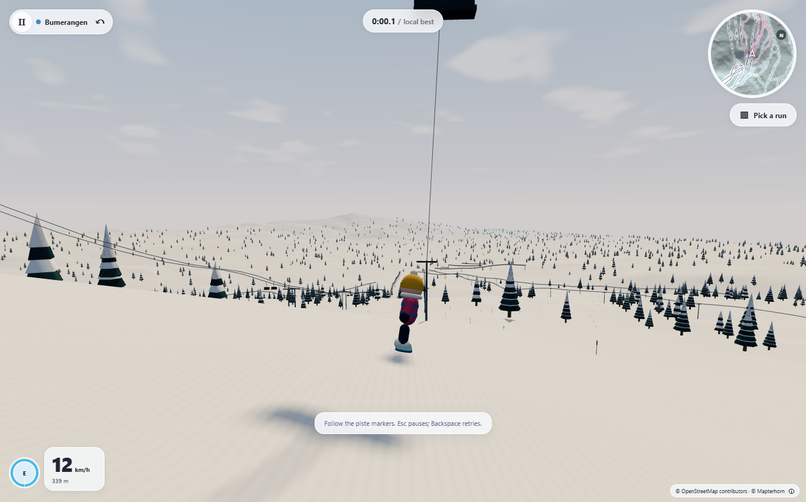

# Nordic Line

A local skiing and snowboarding game that combines the Nordic resort explorer with the newer free-moving mountain prototype. One Three.js renderer and 120 Hz heightfield simulation power both datasets.



[View the preserved Nordic explorer](docs/combined-map.png) · [Local browser verification](docs/verification-0.2.json)

## Play on Windows or macOS

Download and extract the **nordic-line-0.2.0.zip** build artifact from a successful GitHub Actions run. Double-click **Nordic-Line-Offline.html** to play Romme Alpin, Åre, Trysil and Thredbo immediately. This file includes its renderer, terrain and mapped slopes; it needs a modern WebGL 2 browser and makes no network requests. A GPU is recommended.

For the full Nordic map, double-click **Start-Windows.bat** on Windows or **Start Nordic Line.command** on macOS. Python 3 is required for these launchers. Alternatively run `python3 launch.py` (`py -3 launch.py` on Windows). Keep the server window open while playing. The launcher verifies its libraries and downloads any missing files from pinned distributions. After those files are prepared, the map and cached terrain work offline. `node serve.mjs` is another option after `python3 bootstrap.py` has prepared Leaflet.

The repository source ZIP contains the game and data. The Actions build artifact additionally contains the ready-to-open standalone HTML and all browser libraries. Open `index.html` through a local server, rather than directly as a file.

## The combined game

- **Original Nordic explorer:** searchable map, country filters, difficulty-coloured slope lines, lift geometry, and all 569 Nordic area records from the October snapshot. Records without mapped descents remain visibly unavailable for riding.
- **New riding engine:** free steering over the actual heightfield, skis or snowboard, charged jumps, grabs, flips, boost, timed runs, freeride, short instant replay, nearby lifts and personal bests saved on the device.
- **Revised presentation:** rounded original rider, warm sky, groomed-snow shading, denser layered forests, lift cables and chairs, close chase/rider/side cameras, circular relief minimap and compact corner controls.
- **Four featured mountains:** Romme Alpin, Åre, Trysil and Thredbo, with fully bundled elevation and mapped pistes. The Nordic explorer can load the other resorts into the same engine.

The graphics are an independent procedural interpretation of the reference style. They do not reproduce Bonvo's proprietary artwork or application code. Equipment, cameras, snow, trees and lift structures are illustrative.

## Controls

| Keys | Action |
| --- | --- |
| Arrows or WASD | Steer, tuck and brake |
| Hold Space, release | Charge and release a jump |
| Shift or J / K | Grab while airborne |
| Fresh up / down press in the air | Front / back flip |
| E or B | Boost |
| Escape | Pause / resume |
| Backspace | Retry the current run |
| R | Drop back into the current run |
| M or N | Full resort map; N selects the next segment after finishing |
| P | Replay the last few seconds |
| C / V / T | Camera / wide lens / camera settings |
| L | Board a mapped lift within 220 m of its lower endpoint; press again to step off |
| X | Rest in the snow off piste |

The revised bindings follow the [published Bonvo keyboard layout](https://bonvo.ski/en/blog/keyboard-controls). They replace this repository's earlier P-to-pause and N-to-open-the-Nordic-picker mappings. Use **Pick a run → Explore the Nordic resort map** to choose another mountain. Touch controls provide a steering pad, jump, grab and boost.

## Geography and offline coverage

The unchanged Nordic snapshot contains **569 operating downhill area records**, **387 with mapped downhill lines**, **5,187 slope-segment associations** and **1,886 lift-segment associations**. Associations and overlapping area records are not counts of unique official resorts or complete signed pistes.

| Dataset | Bundled measured elevation |
| --- | --- |
| Featured extract | Romme Alpin, Åre, Trysil, Thredbo |
| Nordic explorer | Åre, Trysil, Hemsedal, Hafjell, Levi, Ruka, Hlíðarfjall, Himosvuori |

That provides **ten distinct named mountains** with cached terrain across the two datasets. Other Nordic resorts request Mapterhorn terrain online. If it cannot be obtained, a surface estimated from mapped route heights is explicitly labelled in the setup and during riding. The four featured resorts contain **515 mapped descent segments and 119 lift geometries**, from a separate September vector release; their IDs and counts can differ from the Nordic snapshot.

The standalone HTML contains the four featured resorts. The full server/Pages application also contains the Nordic catalogue. Data are fixed snapshots, not live operating or navigation information.

## Limits

This is an arcade prototype. Snow surface resolution, generated forests and lift models are approximations. There are no surveyed tree collisions, multiplayer, gamepad bindings, original game saves or original leaderboard compatibility. Mapped lines are often individual segments; finishes and markers are generated locally. Replay records recent motion, rather than a full exportable replay. Lift traversal is simplified. This remains browser software on Windows and macOS, rather than a signed native installer.

## Development and verification

Node.js 22+ is used for tests/builds. The game itself has no npm runtime dependencies.

```sh
npm ci
python3 bootstrap.py
npm test
npm run build
npm run build:site
```

`npm test` validates the original Nordic database and terrain checksums, the four featured heightfields, free-moving physics, control bindings and conversion of all eight original cached terrain grids into the shared engine. Python tests validate checksum enforcement and offline reuse of browser libraries.

`npm run test:browser` uses installed desktop Chrome (or `LOCAL_RIDE_BROWSER`) with Playwright. It checks actual WebGL startup, all four featured resorts, the Nordic search/map and Levi terrain, movement, skis/board, boost, pause, replay, retry, cameras, HUD positions and the standalone file. Cached-terrain checks block external requests. Reports and screenshots go to `tests/_artifacts/` and are uploaded by CI.

GitHub Actions checks the simulation and launchers on Linux, macOS and Windows, then builds and browser-tests the combined application on Linux. Build artifacts include the portable ZIP, static site and browser evidence. The separate Pages workflow stages verified libraries before deployment on `main`; GitHub Pages must use **GitHub Actions** as its source. Pull requests build artifacts without deploying the live page.

Main modules: `main.mjs` coordinates the game, `physics.mjs` simulates the rider, `world.mjs` renders the mountain, `resorts.mjs` adapts the original Nordic geography, and `nordic-picker.mjs` / `map.js` implement the explorer. `terrain.js` preserves measured/estimated elevation loading; `terrain.mjs` samples the shared local heightfield. The old entry point and renderer have been removed.

## Sources and licences

Data: [OpenSkiData](https://www.openskidata.org/), [© OpenStreetMap contributors](https://www.openstreetmap.org/copyright), Skimap.org, Who's On First, and [© Mapterhorn and its source providers](https://mapterhorn.com/attribution/). Featured vectors use the [explicitly reusable Bonvo geographic extract](https://bonvo.ski/en/credits). Vector databases and derived piste-distance grids retain ODbL 1.0; elevation retains its source-specific terms. Natural Earth country outlines are public domain.

See [DATA-SOURCES.md](DATA-SOURCES.md), [DATA-LICENSES.md](DATA-LICENSES.md) and each featured resort's `sources.json` for provenance and transformations. Application code and Three.js r172 are MIT; Leaflet 1.9.4 is BSD-2-Clause. Vendor notices are preserved. Neither the application licence nor its packaging changes the geographic data licences.
